# Minecraft server network

Several Minecraft servers behind one address, Java and Bedrock players together – set up safely and kept up to date by itself.

[Deutsch](README.de.md) · An official [Hostwerk](https://github.com/Passimoritz/hostwerk-public) extension (native extension, SDK 3.0; BungeeCord needs Hostwerk 3.2)

Replaces the extension **Bedrock bridge** and the Minecraft part of **Game server network** (which stays for game servers in general).

## The pieces, explained

| Piece | What it is | Where it runs |
|---|---|---|
| **Proxy** (Velocity, BungeeCord) | The one address players connect to. It checks their accounts and sends them to your servers (lobby, survival, minigames); `/server` switches. | Its own server in Hostwerk. Only the proxy is reachable from outside. |
| **Servers behind the proxy** | Normal Paper/Purpur/Folia (and with Velocity also Fabric/NeoForge) servers. | Listen on `127.0.0.1` only and do not check accounts themselves – they trust the proxy (Velocity proves it with a secret). |
| **Geyser** | The *Bedrock bridge*: translates between the Bedrock edition (phone, console, Windows) and Java, so both play together on your Java servers. | **Once on the proxy** for a whole network – or on a single server without a proxy. Never on the servers behind a proxy. |
| **Floodgate** | Lets Bedrock players in without a Java account. | On the proxy **and** on every server behind it, all with the **same key** – otherwise the servers kick Bedrock players. |
| **ViaVersion / ViaBackwards / ViaRewind** | Version bridges: players with a newer / older / very old Minecraft version can join. | On every server behind the proxy (the proxy itself accepts every version). |
| **Bedrock Dedicated Server** | Mojang’s own server for the Bedrock edition: a separate Bedrock world, only Bedrock players, add-ons and redstone exactly like Bedrock. No Java players. | Its own program, managed on this page. |

## What it does

- **Networks**: Velocity (recommended, modern forwarding with a secret) or BungeeCord (for BungeeCord-only plugins); new or existing proxy, optional lobby (flat, adventure, peaceful)
- **Servers**: order (lobby first, then the fallback order), name in the network, direct addresses per server (forced hosts, e.g. `survival.example.org`), maintenance per server (leaves the routing, players go to the lobby, optionally stops the server)
- **Players & permissions**: one whitelist, operators and bans for every server of the network (Java names through Mojang, Bedrock names through the Floodgate prefix); who is online where, moving players between servers
- **Proxy**: MOTD (two lines), server icon (64 × 64 PNG), player count shown, ping passthrough, “second login wins”; changes reload a running proxy (`velocity reload`/`greload`)
- **Start/stop in order**: servers first (each until it is ready), the proxy last; stop the other way round
- **Checks**: only the proxy reachable, forwarding secret on every server, `server-ip=127.0.0.1`, `online-mode` right, Floodgate key everywhere
- **Addresses for friends**: Java and Bedrock, at home and from outside (DynDNS, remote access domain or public IP), forwarding through “Router & port forwarding”
- **Bedrock** – three ways side by side: Geyser + Floodgate on the proxy, on a single server, or your own Bedrock Dedicated Server (install, settings, console, players, public ports)
- **Without maintenance** (everything also in Settings → Self-maintenance):
  - Geyser/Floodgate from the GeyserMC download API with SHA-256, staged and put in when nobody is online; afterwards a RakNet ping must answer – otherwise the previous jars come back and the build is skipped
  - Compatibility first: a Geyser that speaks a newer Java version than a server waits – or installs ViaVersion on that server first (switchable)
  - Proxy builds (Velocity from PaperMC, BungeeCord from SpigotMC’s build server with MD5) when nobody is online, with a way back if the proxy does not get ready
  - Bedrock Dedicated Server from Mojang’s official download list: new version unpacked next to the old one, worlds and settings moved over, probe, way back
  - ViaVersion & co. through Hostwerk’s own plugin updates (Modrinth)

## Moving over from “Bedrock bridge”

Nothing is copied – the data stays where it was (`settings.minecraft.servers[].geyser`, `plugins/floodgate/key.pem`). On its first start this extension reads the real Geyser/Floodgate settings, takes over existing Velocity networks and lists Geyser installations behind a proxy: **“Move to the proxy”** puts Geyser on the proxy with the **same UDP port** (friends keep their address) and the **same Floodgate key**. Hostwerk 3.2 installs this extension by itself for everybody who used the bridge.

## Install

In Hostwerk: **Extensions → Discover** and click “Install”. Native extensions run as part of Hostwerk; Hostwerk only installs them from the official catalogue (with checksum) or in developer mode.

## Data

- `settings.mcNetwork` – networks, Bedrock Dedicated Servers
- `settings.minecraft.servers[].geyser` / `.network` – Geyser state and network membership (shared with Hostwerk’s core)
- `<Hostwerk>/data/bedrock-servers/<id>` – Bedrock Dedicated Servers

Removing the extension deletes nothing.

## Develop

```bash
node --test tests/*.test.js          # tests (no Java, no server, no network – everything simulated)
node build-native.js .               # build the interface (sdk/build-native.js from hostwerk-public)
node check.js . --strict             # same check as the catalogue (sdk/check.js)
```

Interface source in `ui/src`, server part in `server/`. Texts in the code are English, German is in `locales/de.json`.

## License

MIT
